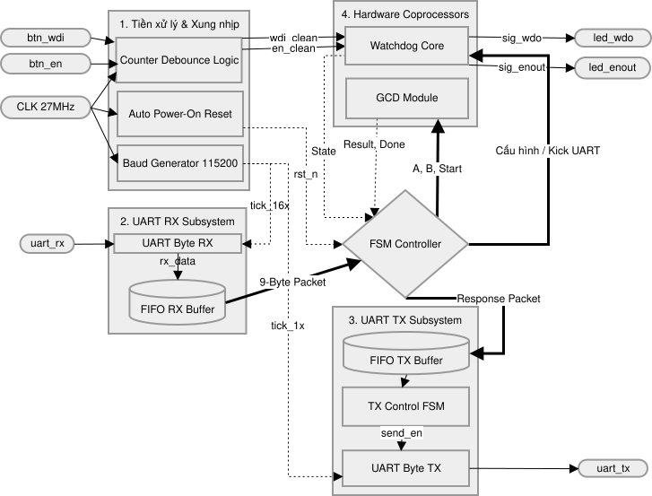

# Tài liệu Kiến trúc Hệ thống (System Top-Level)

## 1. Tổng quan (System Overview)
Module `system_top` là thực thể cao nhất (Top-level Entity) của dự án SoC MissU. Module này đóng vai trò là "bo mạch chủ" kỹ thuật số, thực hiện việc kết nối các phân hệ chức năng, quản lý tín hiệu vào/ra vật lý và điều phối luồng dữ liệu giữa các khối communication, control và processing.

### Các chức năng chính:
- **Quản lý Reset:** Tích hợp bộ tạo reset tự động khi cấp nguồn (`power_on_reset`).
- **Giao tiếp UART:** Xử lý truyền nhận dữ liệu 8-bit với tốc độ 115200 bps thông qua bộ đệm FIFO.
- **Điều khiển Trung tâm:** Giải mã giao thức 9-byte để điều phối hoạt động toàn hệ thống.
- **Tính toán Hiệu năng:** Tích hợp lõi GCD 32-bit.
- **Giám sát An toàn:** Tích hợp Watchdog Core để bảo vệ hệ thống khỏi các trạng thái treo.

---

## 2. Sơ đồ Kiến trúc Hệ thống (System Architecture)

Dưới đây là sơ đồ khối mô tả cấu trúc phân cấp và các kết nối nội bộ của hệ thống:

*Hình 1: Sơ đồ kiến trúc phân cấp của SoC MissU (Click vào ảnh để phóng to)*

---

## 3. Cấu trúc Phân cấp (Hierarchy)

Hệ thống được chia thành các lớp chức năng rõ rệt:

### 3.1. Phân hệ Giao tiếp (Communication Subsystem)
- **baud_gen:** Tạo xung nhịp đồng bộ cho UART.
- **uart_byte_rx / tx:** Chuyển đổi dữ liệu Nối tiếp <-> Song song.
- **fifo_rx / tx:** Bộ đệm dữ liệu giúp ổn định tốc độ truyền dẫn và tránh mất mát gói tin.
- **uart_tx_control:** Điều phối việc lấy dữ liệu từ FIFO để truyền đi.

### 3.2. Bộ điều khiển Trung tâm (Control Layer)
- **fsm_controller:** "Bộ não" của hệ thống. Nó thực hiện máy trạng thái (FSMD) để:
    - Giải mã gói tin UART 9-byte (Check Header, Checksum).
    - Đọc/Ghi dữ liệu vào các thanh ghi ảo.
    - Kích hoạt các lệnh thực thi cho GCD và Watchdog.

### 3.3. Các lõi chức năng (Processing Cores)
- **GCD:** Thực hiện thuật toán Euclid để tìm ước chung lớn nhất của hai số 32-bit.
- **Watchdog_Core:** Giám sát tín hiệu "nuôi chó" (WDI) và quản lý trạng thái lỗi (Fault/WDO).

### 3.4. Xử lý tín hiệu vật lý (Infrastructure)
- **power_on_reset:** Đảm bảo hệ thống khởi động ở trạng thái xác định.
- **debounce:** Khử rung phím cho các nút nhấn vật lý S1 (WDI) và S2 (Enable).

---

## 4. Định nghĩa các chân I/O (Pin Mapping)

| Tên chân | Loại | Mô tả | Linh kiện trên board (Kiwi-1P5) |
| :--- | :---: | :--- | :--- |
| `clk` | IN | Xung nhịp hệ thống (27 MHz) | Crystal Oscillator |
| `uart_rx` | IN | Nhận dữ liệu UART | Cổng USB-UART |
| `uart_tx` | OUT | Truyền dữ liệu UART | Cổng USB-UART |
| `btn_wdi` | IN | Nút "kick" Watchdog vật lý | Nút nhấn S1 (Active Low) |
| `btn_en` | IN | Nút Enable hệ thống vật lý | Nút nhấn S2 (Active Low) |
| `led_wdo` | OUT | Cảnh báo lỗi Watchdog | Đèn LED D3 (Sáng khi lỗi) |
| `led_enout` | OUT | Báo trạng thái hoạt động | Đèn LED D4 (Sáng khi Active) |

---

## 5. Luồng hoạt động (System Flow)

1. **Khởi động:** `power_on_reset` giữ hệ thống ở trạng thái reset trong 255 chu kỳ để ổn định điện áp.
2. **Nhận lệnh:** Dữ liệu từ PC gửi qua UART -> `uart_rx` -> `fifo_rx`.
3. **Xử lý:** `fsm_controller` lấy dữ liệu từ `fifo_rx`, kiểm tra gói tin. Nếu hợp lệ, nó sẽ cập nhật cấu hình cho Watchdog hoặc nạp dữ liệu cho GCD.
4. **Phản hồi:** Kết quả tính toán GCD hoặc trạng thái Watchdog được đóng gói và đẩy vào `fifo_tx` -> `uart_tx` gửi về PC.
5. **Giám sát:** Song song với đó, `Watchdog_Core` liên tục đếm thời gian. Nếu không nhận được tín hiệu "kick" (qua nút bấm hoặc UART) trong thời gian `twd`, nó sẽ kích hoạt `led_wdo`.
