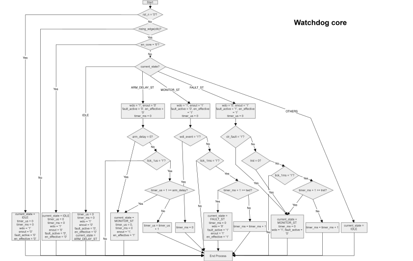

# Tài liệu chi tiết Module Watchdog Core

## 1. Tổng quan
Module **Watchdog_Core** là một thành phần quan trọng trong hệ thống SoC MissU, đóng vai trò giám sát sự hoạt động ổn định của hệ thống. Nó đảm bảo rằng nếu phần mềm hoặc logic điều khiển bị "treo" hoặc không phản hồi trong một khoảng thời gian nhất định, hệ thống sẽ được đưa về trạng thái an toàn hoặc thực hiện reset.

### Đặc điểm chính:
- **Tần số hoạt động:** 27 MHz.
- **Độ phân giải thời gian:** Hỗ trợ đơn vị Microsecond (us) và Millisecond (ms).
- **Cơ chế kích hoạt linh hoạt:** Hỗ trợ cả tín hiệu vật lý (`wdi_clean`) và lệnh từ UART (`kick_uart`).
- **Trạng thái an toàn (Fail-safe):** Tín hiệu `wdo` và `enout` được thiết kế để bảo vệ các thiết bị ngoại vi.

---

## 2. Sơ đồ khối và Cổng giao tiếp 

### Generics
| Tên | Loại | Giá trị mặc định | Mô tả |
| :--- | :--- | :--- | :--- |
| `CLK_FREQ` | INTEGER | 27,000,000 | Tần số clock hệ thống (Hz) |

### Ports
| Tên | Hướng | Độ rộng | Mô tả |
| :--- | :--- | :--- | :--- |
| `clk`, `rst_n` | IN | 1 | Clock hệ thống và Reset (tích cực thấp) |
| `wdi_clean` | IN | 1 | Tín hiệu Watchdog Input đã qua xử lý Debounce |
| `en_clean` | IN | 1 | Tín hiệu Enable từ phần cứng (Switch/Pin) |
| `en_sw` | IN | 1 | Tín hiệu Enable điều khiển bằng phần mềm (qua UART) |
| `clr_fault` | IN | 1 | Lệnh xóa lỗi từ Controller |
| `kick_uart` | IN | 1 | Lệnh "kick" (reset timer) gửi qua UART |
| `twd` | IN | 32 | Ngưỡng thời gian timeout (ms) |
| `trst` | IN | 32 | Thời gian giữ tín hiệu reset khi có lỗi (ms) |
| `arm_delay` | IN | 16 | Thời gian chờ khởi động (us) |
| `wdo` | OUT | 1 | Watchdog Output (Tích cực thấp - Reset ngoại vi) |
| `enout` | OUT | 1 | Cho phép đầu ra hệ thống (Enable Output) |
| `fault_active` | OUT | 1 | Cờ báo hiệu đang trong trạng thái lỗi |
| `en_effective` | OUT | 1 | Trạng thái Enable thực tế của lõi |

---

## 3. Máy trạng thái với datapath (FSMD) 

Module hoạt động dựa trên FSMD sau:

*Hình 1: Sơ đồ FSMD Watchdog Core (Click vào ảnh để xem chi tiết và phóng to)*

---

## 5. Hướng dẫn tích hợp 

Để sử dụng module này trong thiết kế Top-level:
1.  **Kết nối Clock:** Đảm bảo `CLK_FREQ` được cấu hình đúng với tần số thực tế của FPGA .
2.  **Xử lý WDI:** Tín hiệu `wdi_clean` nên được đi qua bộ Debounce trước khi đưa vào module này để tránh các xung nhiễu gây reset nhầm timer.
3.  **Giao tiếp UART:** Các tham số `twd`, `trst`, `arm_delay` nên được kết nối với các thanh ghi cấu hình từ bộ điều khiển UART để có thể thay đổi linh hoạt mà không cần nạp lại code FPGA.
